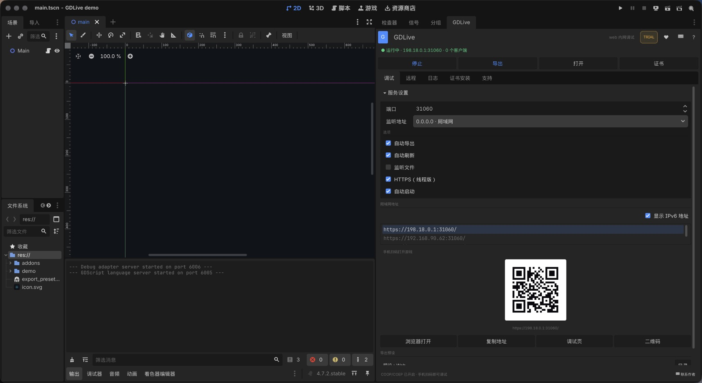

# Godot Live (GDLive)

**A web-game development assistant embedded in the Godot editor.** One-click export to browser, hot reload, HTTPS, browser console relay, phone QR-code debugging, and remote playtesting — without ever leaving the editor.

[简体中文](README.zh-CN.md) | English · Godot 4.7+ · MIT (GDScript & demo) 

This repository is a ready-to-run **demo project with the GDLive plugin included**. Clone it, open it in Godot, enable the plugin, press **Export** — your Web build is served on the LAN within seconds. Scan the QR code with your phone (or click **Open in browser**) and you're playtesting the real build. Edit, save, and the page hot-reloads by itself.

## Quick start

1. Clone this repository (or download it from [Releases](https://github.com/cfping/Godot-Live/releases))
2. Open the project in Godot 4.7+ — the editor may ask to enable the GDLive plugin; say yes (or enable it manually in *Project → Plugins*)
3. In the **GDLive** dock panel, press **Export** — the server starts and the LAN URL appears
4. Scan the QR code with your phone, or press **Open in browser**
5. A 14-day full-featured trial starts automatically on first run — no payment, no credit card

> The plugin ships with prebuilt binaries for macOS, Windows and Linux under `addons/gdlive/bin/`. The Rust core is closed-source; the GDScript panel scripts in this repository are open (MIT) for review and UI contributions.

## Features

- **One-click export & serve** — exports the Web build and serves it on `0.0.0.0` with the COOP/COEP headers threaded builds require; auto re-export on save with browser hot reload (Pro)
- **LAN & IPv6 addresses + QR code** — every local address listed (IPv6 optional), scan to open the game on a phone over Wi-Fi
- **HTTPS out of the box** — one-click local root certificate install; SharedArrayBuffer/threaded builds work on real devices with zero warnings
- **Console relay & in-page debug panel** — `console.log/warn/error`, uncaught exceptions and Promise rejections flow back into the editor's log panel; an injected on-page overlay shows FPS, viewport metrics and captured logs
- **Remote playtesting tunnel (Pro)** — share a time-limited public URL with teammates or clients, no port forwarding; the free tier includes 15-minute sessions
- **Independent support service** — license / purchase / donate / certificate pages run on their own port, unaffected by the game server

## Typical workflow

1. Press **Export** in the GDLive panel — the server starts and the LAN URL appears
2. Scan the QR code with your phone (or click **Open in browser** on desktop)
3. Edit your project and save — the page hot-reloads (Pro); free tier re-exports with one click
4. Browser errors and logs show up directly in the editor's **Log** tab; the on-page overlay gives you FPS and console on the device itself

## Pricing at a glance

- **Free — ¥0 forever**: manual export, local server, QR codes, 15-min remote play sessions
- **Pro — ¥9.9/month · ¥99/year**: auto export + hot reload, HTTPS with a local root certificate, console relay + in-page debug panel, 10 h/month remote play
- **Studio — ¥1699 one-time**: includes full delivery of the server source code and the plugin source code — self-host, rebrand, and extend privately, plus team licensing, 50 h/month remote play with 3 concurrent sessions, and custom domains

License verification is fully offline. Full details are on the pricing page inside the plugin's **Support** tab (opens automatically with the editor).

## Contact

- WeChat: `thingbox`
- Email: chping@iowk.com

## License

- `addons/gdlive/*.gd` (panel scripts), the demo project and website materials in this repository: [MIT](LICENSE) © 2026 GDLive contributors
- The plugin core (prebuilt Rust GDExtension binaries in `addons/gdlive/bin/`) and the remote playtesting server are **not open-source**
