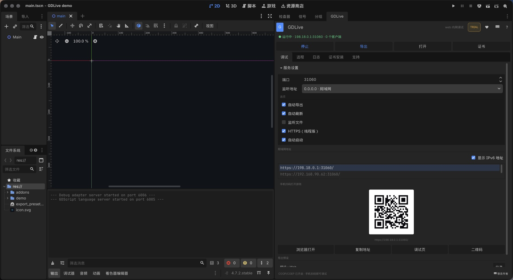

# Godot Live（GDLive）

**内嵌于 Godot 编辑器的 Web 游戏开发辅助插件**：一键导出到浏览器、热刷新、HTTPS、浏览器日志回传、手机扫码真机调试、远程试玩——全程不用离开编辑器。

[English](README.md) | 简体中文 · Godot 4.7+ · MIT（GDScript 与 Demo）

本仓库是一个**开箱即用的 Demo 工程，已内置 GDLive 插件**。克隆后用 Godot 打开，启用插件，点**导出**——Web 构建几秒内即在局域网内可访问。手机扫二维码（或点**浏览器打开**）即可试玩真实构建；修改代码保存后页面自动热刷新。

## 快速开始

1. 克隆本仓库（或从 [Releases](https://github.com/cfping/Godot-Live/releases) 下载）
2. 用 Godot 4.7+ 打开工程——编辑器会提示启用 GDLive 插件，确认即可（也可在 **项目 → 插件** 中手动启用）
3. 在 **GDLive** 停靠面板中点**导出**——服务启动，局域网地址出现在面板
4. 手机扫码，或点**浏览器打开**
5. 首次运行自动开始 14 天全功能试用——无需付款、不绑卡

> 插件自带 macOS / Windows / Linux 预编译二进制（`addons/gdlive/bin/`）。插件核心（Rust GDExtension）不开源；本仓库中的 GDScript 面板脚本以 MIT 开源，欢迎审阅与提交界面改进。

## 功能特性

- **一键导出 + 本地服务** —— 导出 Web 构建并以 `0.0.0.0` 提供服务，自动带上线程版构建必需的 COOP/COEP 头；保存自动重新导出、浏览器热刷新（Pro）
- **局域网 / IPv6 地址 + 二维码** —— 列出本机全部局域网地址（可选显示 IPv6），手机扫二维码即可通过 Wi-Fi 真机调试
- **开箱即用的 HTTPS** —— 一键安装本机根证书；线程版构建在真机上零警告运行
- **日志回传 + 页面调试面板** —— `console.log/warn/error`、未捕获异常、Promise rejection 实时回传到编辑器日志面板；页面注入的浮层直接显示 FPS、可视区域与捕获日志
- **远程试玩隧道（Pro）** —— 生成限时公网链接发给同事或客户，无需端口映射；免费版含 15 分钟/次体验
- **独立支持服务** —— 授权 / 购买 / 赞赏 / 证书页面运行在独立端口，与游戏服务器互不影响

## 典型工作流

1. 在 GDLive 面板点**导出**——服务启动，局域网地址出现在面板
2. 手机扫码（或桌面点**浏览器打开**）
3. 修改项目并保存——页面热刷新（Pro）；免费版点一下即可重新导出
4. 浏览器报错与日志直接显示在编辑器**日志**页；设备上的页面浮层可查看 FPS 与控制台

## 定价速览

- **免费版 ¥0 / 永久**：手动导出、本地服务、二维码、15 分钟/次远程试玩
- **Pro ¥9.9/月 · ¥99/年**：自动导出 + 热刷新、HTTPS + 本机根证书、日志回传 + 页面调试面板、10 小时/月远程试玩
- **Studio ¥1699/套·一次性**：含服务端源码与插件源码完整交付，可私有化部署、二次开发与自定义品牌；另含团队授权管理、50 小时/月远程试玩（3 并发）与自定义域名

授权验证完全离线。完整定价见插件**支持**页（随编辑器自动打开）。

## 联系方式

- 微信：`thingbox`
- 邮箱：chping@iowk.com

## License

- 本仓库中的 `addons/gdlive/*.gd`（面板脚本）与 Demo 工程：[MIT](LICENSE) © 2026 GDLive contributors
- 插件核心（`addons/gdlive/bin/` 内的 Rust GDExtension 预编译二进制）与远程试玩服务器**不开源**
